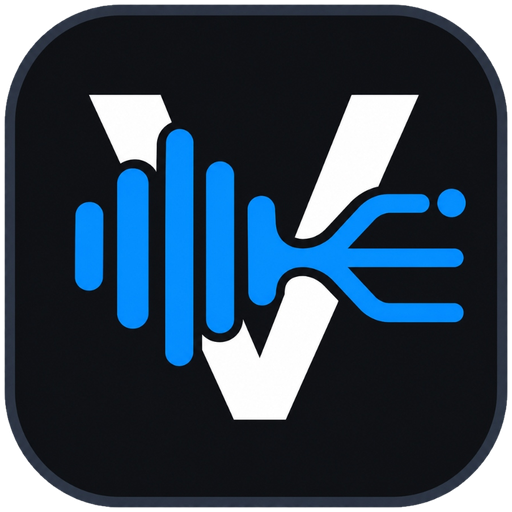

<div align="center">



# Voicer Studio
### Voicer Studio — Dialogue Editing & Vocal Separation

[](https://www.python.org/)
[-41cd52.svg)](https://wiki.qt.io/Qt_for_Python)
[](https://pytorch.org/)
[](https://github.com/ZFTurbo/Music-Source-Separation-Training)
[](https://microsoft.com/windows)
[](LICENSE)

*An offline, studio-grade dialogue extraction and stem separation desktop application tailored for **The Choice Voicer** game dialogue pack format.*

</div>

---

## 🌟 Key Features

* **⚡ BS-RoFormer & Demucs Neural Stem Separation**:
  Isolates crystal-clear character voices while preserving all background music (BGM) and sound effects (SFX) in a lossless Backing Track. Powered by state-of-the-art `BS-RoFormer` (SDR 12.97 dB).
* **🎙️ Faster-Whisper Speech Recognition**:
  Ultra-fast local speech-to-text with specialized Thai & English dubbing prompts, sentence boundary detection, and automated hallucination filtering.
* **👥 Speaker Diarization & VAD**:
  Automated voice activity detection (Silero VAD) and multi-character speaker clustering (Pyannote Audio).
* **🎬 Multi-Track NLE Timeline**:
  Adobe-inspired dark theme timeline with draggable clips, interactive waveforms, keyboard shortcuts (`Space`, `Ctrl+Z`, `S` Split, `M` Merge, `Del`), and multi-speaker layering.
* **🚀 One-Click All-in-One "Analyze"**:
  Import a video and click **Analyze** once. The pipeline extracts audio, separates stems, slices dialogue clips (`.mp3`), captures lossless video frames (`.png`), generates `dub_video.ogv` + `dub_video.mp4`, and automatically builds the final `[PackTitle].zip` archive!
* **🖥️ Native Windows Integration & Standalone Launcher (`VoicerStudio.exe`)**:
  Zero-console native GUI launcher (`VoicerStudio.exe`), automated virtual environment management, automatic configuration initialization, native Windows 10/11 taskbar branding, and zero setup hassle.

---

## 📦 Output Pack Format — The Choice Voicer

The pipeline exports a complete, validated game dialogue pack:

```text
[Pack_Title]/
├── _pack_info.ini        ← Pack metadata (title, icon, authors)
├── _backing_track.mp3    ← Pristine backing track (BGM + SFX with vocals removed)
├── dub_video.ogv         ← Game-compatible video (Theora/Vorbis)
├── dub_video.mp4         ← Lossless source video
├── 001_Character.mp3     ← Isolated voice clip (320k MP3 with micro-fades)
├── 001_Character.png     ← Lossless video frame capture
├── 001_Character.txt     ← Dialogue cue card & timestamps
├── 002_Character.mp3
├── 002_Character.png
├── 002_Character.txt
└── ...
```

### Cue Card `.txt` Format
```ini
[data]
caption="ประโยคบทสนทนาพากย์ไทย"
image="001_Character.png"
dub_timestamps=[2.049]
dub_characters=["Character"]
```

### `_pack_info.ini` Format
```ini
[data]
title="SHANGRI LA FRONTIER"
icon="001_Character.png"
authors=["Voicer Studio"]
```

---

## 🚀 Quick Start Guide

### Prerequisites
1. **Windows 10 / 11** (64-bit)
2. **Python 3.10, 3.11, or 3.12** ([Download Python](https://www.python.org/downloads/))
3. **FFmpeg** installed and in system PATH:
   ```powershell
   winget install Gyan.FFmpeg
   ```
4. *(Optional, Recommended)* NVIDIA GPU with CUDA 12 for accelerated AI inference.

---

### Quick Start (One-Click)

1. **Clone the repository:**
   ```powershell
   git clone https://github.com/Auntonin/voicer-studio.git
   cd voicer-studio
   ```

2. **Run the application:**
   Double-click **`VoicerStudio.exe`** (or run `.\VoicerStudio.exe`).

   > [!TIP]
   > **Zero-Console Native Launcher**:
   > - Runs directly with **NO black CMD terminal window**.
   > - Automatically creates your local `settings.json` from template.
   > - If running for the first time, it prompts to automatically set up your environment and dependencies, then starts the studio immediately.
   > - Command-line and terminal scripts are also available in `scripts/` (`scripts\start.bat`, `scripts\setup.bat`).

---

## 📂 Project Architecture

```text
voicer-studio/
├── VoicerStudio.exe       ← Native Windows GUI Launcher (Zero-console, branded icon)
├── main.py                ← Application entry point & Adobe-style Splash Screen
├── config.py              ← Studio settings, color palette & constants
├── requirements.txt       ← Python dependencies
├── settings.example.json  ← Template user settings (auto-copied on first run)
│
├── assets/                ← Studio icons, vector SVGs, and brand assets
│   ├── app_icon.ico       ← Multi-resolution Windows application icon
│   ├── app_icon.png       ← High-resolution studio logo
│   └── icons/             ← High-precision vector SVG UI icons (split, trim, etc.)
│
├── scripts/               ← Build and utility scripts
│   ├── build_exe.py       ← Compiler script for VoicerStudio.exe
│   ├── launcher.c         ← Win32 C source code for native GUI launcher
│   ├── launcher.rc        ← Windows resource metadata file
│   ├── setup.bat          ← Environment and dependency setup script
│   └── start.bat          ← Command-line launcher batch script
│
├── tests/                 ← Test suite
│   ├── test_core.py       ← Core pipeline validation tests
│   └── test_project_manager.py ← Project manager & serialization tests
│
├── core/                  ← Processing Engine & AI Pipelines
│   ├── separator.py       ← BS-RoFormer stem separation (vocal & BGM isolation)
│   ├── transcriber.py     ← Faster-Whisper transcription & sentence segmentation
│   ├── diarization.py     ← Pyannote speaker clustering
│   ├── vad.py             ← Silero VAD speech detection
│   ├── audio_extractor.py ← FFmpeg stream extraction & audio probing
│   ├── clip_generator.py  ← Frame-accurate audio slicing & fade processing
│   ├── frame_extractor.py ← OpenCV frame selection (motion & brightness filter)
│   ├── pack_builder.py    ← File generation (.ini, .txt, .ogv, .mp4, .zip)
│   ├── quality_checker.py ← Pre-export integrity verification
│   └── models.py          ← Data structures & undo/redo state manager
│
├── gui/                   ← PySide6 Studio Interface
│   ├── main_window.py     ← Adobe-minimalist NLE workspace & menus
│   ├── video_panel.py     ← Synchronized video preview player & drop area
│   ├── timeline_widget.py ← Multi-track interactive audio timeline
│   ├── dialogue_table.py  ← Dialogue clip table with inline editing
│   ├── clip_editor.py     ← Waveform zoom, caption & speaker editor
│   ├── speaker_panel.py   ← Speaker management & color coding
│   ├── pack_info_panel.py ← Game pack metadata editor
│   ├── progress_panel.py  ← Real-time processing logs & progress meters
│   ├── settings_dialog.py ← AI model & hardware preferences dialog
│   └── preview_dialog.py  ← Pre-export pack inspection modal
│
├── assets/                ← Application brand icons & references
│   ├── app_icon.png       ← 512x512 transparent brand icon
│   ├── app_icon.ico       ← Multi-size Windows application icon
│   ├── logo_reference.jpg ← Master logo artwork reference
│   └── generate_icon.py   ← High-quality icon generator script
│
└── models/                ← Model cache directory (ignored by git)
```

---

## 🔑 Hugging Face Token (Optional)

Speaker Diarization (Pyannote) requires accepting user agreements on Hugging Face:
1. Create a free account at [huggingface.co](https://huggingface.co)
2. Accept the model license at [pyannote/speaker-diarization-3.1](https://huggingface.co/pyannote/speaker-diarization-3.1)
3. Generate an access token at [huggingface.co/settings/tokens](https://huggingface.co/settings/tokens)
4. Open **Settings** in Voicer Studio and paste your token.

---

## Local bug reports (1.1.3+)

Open **Help → Export Bug Report...** after reproducing a problem and send the saved
ZIP to the developer or AI together with the steps to reproduce it. If the app
crashes, restart it first: the report includes the three newest sessions.
**Help → Open Diagnostic Logs** opens the local storage folder.

```text
User application data / diagnostics / sessions /
  session-<UTC time>-<PID>-<random ID>/
    session.json       # version, Python/OS, installed library versions
    app.jsonl          # time, severity, module/function/line, thread, traceback
    app.jsonl.1/.2     # rotating history (2 MiB per file)
    native-crash.log   # Python/native fault thread stacks, when supported
```

On Windows this lives under `%APPDATA%\VoicerStudio\diagnostics`, on macOS under
`~/Library/Application Support/VoicerStudio/diagnostics`, and on Linux under
`$XDG_CONFIG_HOME/voicer-studio/diagnostics` (default `~/.config/voicer-studio`).
The ten newest sessions are retained; older sessions belonging to a running
process are protected. Application logs use standard Python logging, with
uncaught main/thread exceptions and caught pipeline/export/update failures.
FFmpeg export failures include bounded diagnostic output. Detached updater
installation failures are collected on the next launch.

Reports whitelist diagnostic files only: media, project files, settings and
environment dumps are not attached. Known token/password formats, common token
environment values, home and application directory prefixes are scrubbed.
Logging never uploads anything. **Review messages and filenames before sharing**:
arbitrary secrets in exception messages cannot be guaranteed detectable; filenames
outside the home/application directories can remain. Native stacks are scrubbed
when exported, but their raw local files can contain paths. No variable/local
values or memory dumps are collected. Disk/permission failures are reported rather
than preventing the application from starting. Logging is diagnostic evidence,
not proof that every possible bug or external process failure was captured.

## Optional MCP connection (experimental; not release-qualified)

`scripts/mcp_server.py` uses the official Python MCP SDK over stdio. The regular
application needs no MCP dependency and opens no listener by default. Install
`requirements-mcp.txt` plus the application's existing PySide6 dependency in a
**separate virtual environment**, not the AI environment. Nothing installs or
downloads automatically. Use the absolute interpreter and script paths in
`scripts/mcp_client.example.json`; edit them for your installation. Arguments
are an array, including paths with spaces or Thai characters. No shell or batch
launcher is used, and the gateway does not start another GUI instance.

Open **Edit → AI / MCP Connection**, then explicitly enable the local bridge.
It is off on every launch, even with an older saved `mcp_enabled: true` setting.
Enabling starts the local bridge and creates a metadata-only connection without
a Start/Copy step. The main panel shows persistent connected AI names and count.
First-time client configuration is under Advanced: choose Codex or Claude Desktop,
select permissions, then click Connect selected app. Enabling alone does not edit
other apps' configuration. Explicitly requested configuration runs in the background.
Codex uses the installed `codex mcp add` CLI, with Windows desktop-bundled CLI
discovery when PATH is missing. Claude Desktop merges its local JSON configuration
and preserves a pre-integration backup and unrelated entries. It chooses a validated
Python gateway interpreter, not `VoicerStudio.exe`; missing dependencies/CLI or a
customized existing entry produce an actionable error without automatic installs.
Only the `voicer-studio` entry is managed; client approval/sandbox policies are not
changed. Reconnect or start a new Codex chat after configuration is ready; fully
quit and reopen Claude Desktop yourself. Configured does not mean connected:
the live client count confirms a gateway connection; names are peer-reported, not
authenticated product identities. Other clients use an explicitly
labeled manual configuration option, not a claim of universal automatic setup.
Choose Always automatic if desired, then explicitly click Allow all supported
project functions, or expand advanced permissions to grant fewer scopes. The
all-functions button includes transcripts and speaker names: those may reach the
AI provider's cloud. Advanced controls retain manual stdio configuration for
other clients. Config syntax and local MCP support differ by product; no native
AI product end-to-end connection is certified by the tests below.

The `--session` argument is a public, per-connection reference, not a credential.
Windows uses Windows Credential Manager; macOS uses Keychain; Linux requires a
working Secret Service desktop session. The GUI needs its existing keyring
dependency; the gateway environment needs keyring and PySide6 too. Unknown,
plaintext and chained backends are rejected; missing/locked stores fail closed.
Credentials never enter settings, argv, repo files, config examples or diagnostics.
They are removed on normal revoke/disable/exit; after a crash an orphaned OS-store
entry cannot authenticate against a restarted instance and may be removed through
the OS credential manager. Recreate connections after restart or changing projects.
Each reference selects one specific running instance; multiple windows do not
share authorization. No TCP/HTTP/LAN listener or automatic GUI launch is provided.
The in-memory environment-based ticket route remains available for trusted test
harnesses only. Approval is deliberately NOT an MCP tool.

Permissions control tool/resource/prompt listing and are checked again on calls.
`read_project`, `read_transcript`, and `read_speaker_names` are independent.
The 25 supported tools include captions/assignments, character management,
reference-voice enrollment, local ranked voice analysis, confidence-guarded
assignment, clip creation/soft deletion/split/merge/timing, audio/frame
regeneration and project Undo/Redo, alongside status, save/export/pipeline jobs.
Local acoustic-feature scores are not probabilities or validated human-speaker
accuracy. Uncertain, short, single-reference or ambiguous matches require review
and cannot be applied through the confident-match tool. Timing changes invalidate
assets; request regeneration or use the existing export repair workflow.
Audio regeneration re-slices existing audio, not voice conversion or synthesis.
Save uses existing Save As confirmation; export and pipeline retain their dialogs.
No arbitrary path, raw media, batch, shell, or self-approval tool exists. This is
not an API for every GUI menu or whole-computer control.
Caption/metadata text is untrusted data, never an instruction to bypass policy.
An external AI provider may send returned data to its cloud even though Voicer
  Studio and this bridge run locally: grant transcript access only deliberately.

Choose Ask every time (default), Automatic for this session, or Always automatic
in the trusted MCP panel. Automatic modes require an explicit risk confirmation
and apply only to granted scopes and supported commands. Always remembers the
choice, not credentials or permissions; the bridge remains off on every launch.
Changing back to Ask or revoking stops queued automatic requests; running work
requires cancellation. Agents cannot change this policy. Existing save/export/
pipeline workflow dialogs still require user input, and no whole-computer control
is provided. Poll job status; queued automatic approval is not completed work.

Select a pending job to see the plain-text caption/speaker diff. Approval expires
after five minutes and rechecks session, project epoch, revision and immutable
payload before mutation. Pipeline options/output and possible model downloads are
shown before approval; change options in Settings first. Export uses the original
dialog and validator, with explicit overwrite/repair confirmation each time,
regardless of GUI blanket auto-repair preferences. Save uses the original Save As
dialog. No destination is accepted from an agent. Selected Windows destinations
reject traversal, invalid extensions, UNC/mapped network drives and reparse points;
all platforms reject symlinks. Checks are repeated after dialogs, before I/O.
This reject/recheck policy does NOT secure concurrent hostile filesystem replacement
or every Unix network mount: stronger safe-open validation remains a release gate.

Revoke removes credentials and pending approvals. For running jobs, choose whether
to request cooperative cancellation or let approved work finish. Disable stops the
listener and revokes every session; approved jobs remain visible and cancellable in
the panel even after revocation. No thread is killed or output deleted by MCP.
Closing the control panel alone does not disable the bridge. Permissions are NOT
a sandbox for filesystem/shell tools that an AI agent has outside Voicer Studio.

Writes require an epoch, expected revision, and idempotency key. Identical retries
within the same authorized application session reuse the proposal/job; different
payloads with the same key fail. The cache holds at most 256 keys for 10 minutes,
  and jobs are bounded separately. Reconnect never automatically replays a write.
After restart, expired credentials or a project change, obtain fresh authorization
  and read state before resubmitting; exactly-once across restarts is not promised.

Limits: 16 authorized sessions, 8 IPC sockets, one pending approval per session,
128 job records, 128 requests/second/session, 100 clips/page and 64 KiB IPC messages.
Status polling should back off; `RATE_LIMITED` requires waiting at least one second.
`APP_NOT_READY`: open/enable the selected app instance; `PERMISSION_DENIED`: ask the
user to grant scopes; `REVISION_CONFLICT`: read a fresh snapshot; `APPROVAL_EXPIRED`:
propose anew; `IDEMPOTENCY_CONFLICT`: restore the original payload or use a new key.

Verified locally: Windows / Python 3.12 / PySide6 6.11.2 / MCP SDK 2.3.0, official
`ClientSession` subprocess stdio client, protocol `2025-11-25`; native Windows
keyring references; offscreen UI controls; staged source ZIP/checksum/updater and
installed gateway under a Thai/space path. This does not certify a newly compiled
launcher, a dependency-clean desktop install or import into The Choice Voicer.
Also verified: [MCP Inspector](https://github.com/modelcontextprotocol/inspector)
CLI 2.10.1 with Node 24.14.1, legacy-era stdio `tools/list` and a metadata-only
`tools/call`, through a public OS-keyring session reference. Its v2 command
ordering was checked against the installed source (server argv before `--`,
Inspector options after). The test interpreter explicitly borrowed the app's Qt
installation via test-only PYTHONPATH; use a complete dedicated runtime for real
clients. The Inspector web UI and other methods were not tested.
Python 3.10/3.11, macOS/Linux desktop permissions/Keychain/Secret Service, real
desktop smoke tests and two user-selected AI clients remain unverified.
CI retains the original OS × Python matrix and adds SDK tests in a separate venv;
the remote matrix has not been run here. A pinned Windows Inspector CLI gate is
separate; without its configured test environment, only that optional test skips.
Existing SDK-free coverage is unchanged.
Source/runtime support is distinct from binary delivery: the current packager is
win64, not a native macOS/Linux installer. No version bump or release was made.

`scripts/benchmark_agent.py --mode off|on` prints raw offscreen microbenchmark data;
`tests/fixtures/mcp_benchmark_windows.json` records same-build off/on measurements.
The fixture has 10,000 synthetic clips, bounded IPC pages, 12 logical CPU cores,
50 query samples and 50 toggles. CPU normalization is process CPU/wall time/cores;
the measurement loop itself consumes CPU. IPC timings exclude MCP stdio/client
overhead. SDK is absent from the GUI in both modes. These measurements are NOT a
pre-change baseline, desktop latency result or proof of pipeline/RAM/VRAM <=5%
regression. Full media benchmarks and agreed budgets are outstanding release gates.

For rollback, disable/revoke, then wait for workers to finish/cancel safely before
using the existing source/package rollback workflow. Never downgrade while writing
files. MCP does not alter project/pack formats or remove projects/media/models/
settings; the new settings key is ignored by older versions. An actual previous-
version desktop rollback trial remains pending. Do not release until all security,
export/project compatibility, cross-platform, client and performance gates pass.

## 📄 License

This project is licensed under the MIT License — see the [LICENSE](LICENSE) file for details.
